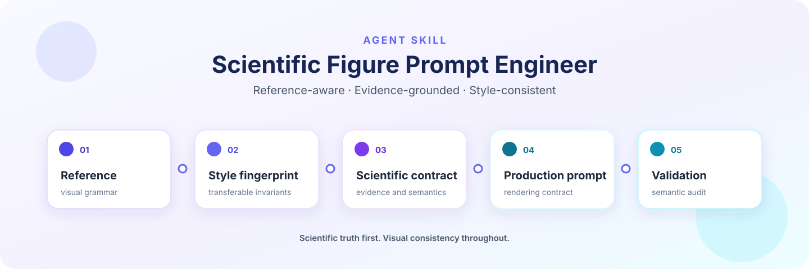
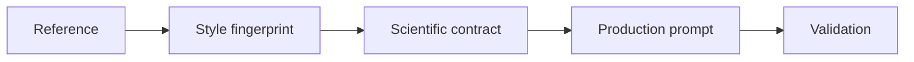

<p align="center">
  
</p>

<p align="center"><strong>Turn reference figures into scientifically faithful, style-consistent image-generation prompts.</strong></p>

<p align="center">
  <strong>English</strong> · <a href="README.zh-CN.md">简体中文</a>
</p>

<p align="center">
  <a href="https://github.com/kikixiong/craft-scientific-figure-prompts/actions/workflows/tests.yml"></a>
  <a href="LICENSE"></a>
  
  
</p>

## Why this skill

A polished scientific figure can still be wrong. A prompt may accidentally
copy the reference's subject matter, invent unsupported evidence, collapse
models, layers, hops, branches, and outputs into one visual idea, or let a
carefully established style drift from figure to figure.

`craft-scientific-figure-prompts` turns figure prompting into an explicit,
auditable workflow. It separates the source of visual grammar from the source
of scientific truth, records what the figure may and may not claim, and writes
a production prompt as a rendering contract rather than a loose collection of
style adjectives.

By default, the skill produces and audits prompts. It generates an image only
when you separately request image generation.

## What it can do

Choose the mode that matches the work in front of you:

| Mode | Use it when you need to… | Primary result |
| --- | --- | --- |
| **Learn** | understand the transferable visual and organizational grammar of a reference | a style fingerprint without copied scientific content |
| **Adapt** | turn a paper, thesis, proposal, or technical brief into a new figure prompt | a scientific content contract and production prompt |
| **Template** | create a reusable scaffold for a recurring figure type | a structured prompt with explicit placeholders |
| **Audit** | inspect an existing prompt or generated figure for semantic, evidence, layout, or style failures | a classified defect report and targeted fixes |
| **Iterate** | correct one failed constraint while preserving an accepted figure's invariants | a revision contract and narrowly scoped prompt update |

The skill is designed for overview figures, method diagrams, architecture
schematics, graphical abstracts, research posters, and multi-figure projects
that need a coherent visual system.

## How it works

The core workflow moves from evidence to a checked artifact:



1. **Reference** — inspect the figure for canvas, hierarchy, typography,
   palette, icon, container, arrow, and density grammar.
2. **Style fingerprint** — retain transferable visual invariants while
   prohibiting leakage of the reference's scientific content.
3. **Scientific contract** — use the target research to define the semantic
   spine, required objects, exact terminology, non-claims, unknowns, and the
   bearer of each evidence state.
4. **Production prompt** — map scientific objects to visual roles and specify
   the result from global constraints down to panels, labels, and connectors.
5. **Validation** — run static checks, then audit scientific meaning, status
   scope, architecture semantics, legibility, and project-wide style binding.

Scientific truth and evidence state outrank aesthetics throughout. A reference
normally supplies visual grammar; your paper, repository, or brief supplies
scientific content.

## Quick start

The portable flow is intentionally simple:

1. Install the complete repository folder, including `SKILL.md`, `references/`,
   `assets/`, and `scripts/`.
2. Let your agent discover `SKILL.md`, or explicitly ask it to read that file.
3. Provide a reference figure and the target paper, thesis, repository, or
   scientific brief.
4. Choose **Learn**, **Adapt**, **Template**, **Audit**, or **Iterate** mode.
5. Save the resulting artifacts and validate the prompt and any project style
   profile before using them for image generation.

For [Codex](https://developers.openai.com/codex/skills) or
[Cursor](https://cursor.com/docs/skills), install the folder in the compatible
user-level skills location:

```bash
mkdir -p ~/.agents/skills
git clone https://github.com/kikixiong/craft-scientific-figure-prompts.git \
  ~/.agents/skills/craft-scientific-figure-prompts
```

For [Claude Code](https://code.claude.com/docs/en/skills):

```bash
mkdir -p ~/.claude/skills
git clone https://github.com/kikixiong/craft-scientific-figure-prompts.git \
  ~/.claude/skills/craft-scientific-figure-prompts
```

Already cloned the repository elsewhere? Use the generic fallback: tell your
agent to read the repository's `SKILL.md` and follow it for the task. This also
works with agents that can read Markdown instructions but do not implement a
skills directory convention.

## Use it with your agent

Agent integration is file-based; there is no runtime package to import.

| Agent | Where to learn the convention | Recommended loading path |
| --- | --- | --- |
| [Codex](https://developers.openai.com/codex/skills) | official Agent Skills documentation | clone to `~/.agents/skills/craft-scientific-figure-prompts` and invoke the skill |
| [Cursor](https://cursor.com/docs/skills) | official Agent Skills documentation | clone to `~/.agents/skills/craft-scientific-figure-prompts` and invoke the skill |
| [Claude Code](https://code.claude.com/docs/en/skills) | official Skills documentation | clone to `~/.claude/skills/craft-scientific-figure-prompts` and invoke the skill |
| Other Markdown-capable agents | the agent's own instruction-loading documentation | clone anywhere, then explicitly ask the agent to read this repository's `SKILL.md` |

Here is a truthful, copy-paste starting request:

```text
Use craft-scientific-figure-prompts in Adapt mode.

Treat the attached figure as visual grammar only. Use my paper as the
scientific source of truth. Produce a style fingerprint, a scientific content
contract, a copy-paste production prompt, and an audit note. Do not generate
an image yet.
```

Replace “my paper” with the authoritative source you actually have. If a
claim, quantity, formula, result, or direction is absent from that source, the
skill should preserve it as unknown rather than fill the gap aesthetically.

## Validate your prompts

The repository includes dependency-free Python validators. Python 3.11+ is
required because the style-profile validator uses the standard-library
`tomllib` module.

After saving a project profile and production prompt, run both checks exactly
as follows:

```bash
python scripts/validate_style_profile.py .codex/figure-style.toml
python scripts/validate_prompt.py \
  --style-profile .codex/figure-style.toml \
  path/to/production-prompt.md
```

The profile validator checks required fields, statuses, colors, placeholders,
and project-wide invariants. The prompt validator checks the layered prompt
contract, unresolved placeholders, style-profile binding, and common semantic
failure signals. Static validation is a gate, not a substitute for reviewing
the prompt against the scientific source.

For an iteration prompt with an explicit revision scope and style lock, add
`--iteration` to `validate_prompt.py`.

## Project-wide visual consistency

For a project that has or may have multiple figures, keep one canonical style
authority at:

```text
<project-root>/.codex/figure-style.toml
```

Start from the [style-profile template](assets/project-figure-style.toml),
replace its placeholders, and keep the profile in `draft` status until the
user accepts the style or an artifact using it. An accepted profile is a
versioned authority for fonts, palette, density, icons, containers, arrows,
background, and anti-style rules—not an optional mood board.

Every production prompt should bind the current profile ID and version and
materialize its relevant values. Image generators cannot read the TOML file
by reference. A scientifically necessary figure-specific exception may change
one property, but it should state its reason and preserve every other
project-wide invariant.

## Project structure

The most useful entry points are:

- [`SKILL.md`](SKILL.md) — the complete agent workflow and behavioral
  boundaries.
- [`references/reference-analysis.md`](references/reference-analysis.md) — a
  formal method for extracting a style fingerprint from dense references.
- [`references/prompt-architecture.md`](references/prompt-architecture.md) —
  prompt section order, layout patterns, and the canonical scaffold.
- [`references/architecture-semantics.md`](references/architecture-semantics.md)
  — rules that keep models, layers, hops, branches, residuals, and outputs
  distinct.
- [`references/project-style-profile.md`](references/project-style-profile.md)
  — the profile lifecycle, precedence rules, exceptions, and validation flow.
- [`references/audit-and-iteration.md`](references/audit-and-iteration.md) — the
  audit rubric and targeted revision protocol.
- [`references/worked-example.md`](references/worked-example.md) — a concrete
  example of the layered prompt format.
- [`assets/project-figure-style.toml`](assets/project-figure-style.toml) — the
  canonical project-style template.
- [`scripts/validate_prompt.py`](scripts/validate_prompt.py) — the production
  prompt validator.
- [`scripts/validate_style_profile.py`](scripts/validate_style_profile.py) —
  the project profile validator.
- [`scripts/test_validate_prompt.py`](scripts/test_validate_prompt.py),
  [`scripts/test_validate_style_profile.py`](scripts/test_validate_style_profile.py),
  and [`scripts/test_repository_docs.py`](scripts/test_repository_docs.py) —
  the validator and repository-document test suites.

## Design principles

- **Separate style from content.** References contribute visual grammar;
  target research contributes the claims, terminology, relationships, and
  evidence state.
- **Make non-claims explicit.** Do not invent an absent formula, result,
  causal mechanism, comparison winner, completed stage, or success signal.
- **Scope evidence precisely.** A verified artifact is not automatically a
  verified scientific claim, and a pending outcome does not identify an
  unfinished internal stage unless the source says so.
- **Keep structural quantities independent.** Model count, sequential depth,
  graph hops, computation branches, output dimensions, and residual meaning
  must remain visually and semantically distinct.
- **Prefer contracts over adjectives.** Specify roles, exact text, geometry,
  connectors, failure constraints, and validation criteria in a stable order.
- **Revise locally.** In Iterate mode, change only the named defect class and
  preserve accepted content, layout, density, typography, palette, and style.
- **Treat validation as layered.** Static checks catch structural omissions;
  a semantic audit still decides whether every visible claim and arrow is
  scientifically licensed.

## Contributing

Issues and focused pull requests are welcome. Contributions should preserve
scientific truth, evidence-state scoping, and semantic distinctions. Keep the
skill agent-neutral, avoid invented compatibility or performance claims, and
add reusable guidance only when it generalizes beyond one project.

Before submitting a change, run the full test suite:

```bash
python -m unittest discover -s scripts -p 'test_*.py'
```

If you change validator behavior, add a regression test that exercises the
real command or validation function. If you change documentation, check every
relative link and keep the English and Simplified Chinese guides structurally
aligned.

## License

Released under the [MIT License](LICENSE).
