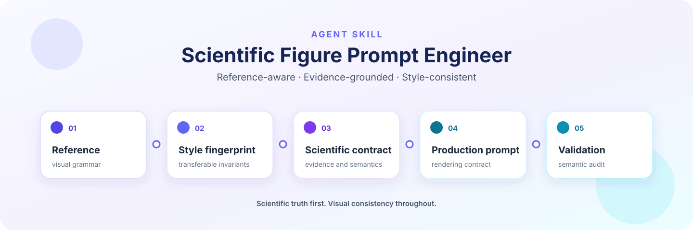

<p align="center">
  
</p>

<p align="center"><strong>将参考图转化为科研绘图提示词，再直接生成并检查所需图像。</strong></p>

<p align="center">
  <a href="README.md">English</a> · <strong>简体中文</strong>
</p>

<p align="center">
  <a href="https://github.com/kikixiong/craft-scientific-figure-prompts/actions/workflows/tests.yml"></a>
  <a href="LICENSE"></a>
  
  
</p>

<p align="center"><a href="#快速开始">从快速开始入门</a></p>

## 为什么需要这个技能

精美的科学图仍然可能是错的。提示词可能会不慎照搬参考图的研究对象、虚构没有依据的证据，
也可能把模型、层、跳数、分支和输出混成一个视觉概念，或者让一套精心确立的风格在不同图之间
逐渐走样。

`craft-scientific-figure-prompts` 将科研绘图提示词的编写变成一套明确且可审计的工作流。
它将视觉语法的来源与科学事实的来源分开，记录图中可以和不可以表达的内容，并把生产级
提示词写成一份渲染契约，而不是一串松散的风格形容词。

请求成图时，技能会在同一任务中编写并审计提示词、调用可用生图工具，再检查成图。
明确要求只要提示词时，会在验证后停止。Learn、Template 和仅审查请求不会触发生图。

## 它能做什么

请根据当前任务选择相应模式：

| 模式 | 适用场景 | 主要产物 |
| --- | --- | --- |
| **Learn** | 理解参考图中可迁移的视觉与组织语法 | 一份不复制科学内容的风格指纹 |
| **Adapt** | 将论文、学位论文、项目申请书或技术简报转化为新的绘图提示词 | 科学内容契约、生产级提示词和所需成图 |
| **Template** | 为经常使用的图形类型创建可复用骨架 | 带有明确占位符的结构化提示词 |
| **Audit** | 检查已有提示词或生成图中的语义、证据、布局或风格问题 | 分类后的缺陷报告和针对性修复方案 |
| **Iterate** | 在保留已认可图形不变量的同时，修正一个未满足的约束 | 修订契约和范围严格受控的提示词更新 |

这个技能适用于概览图、方法流程图、架构示意图、图形摘要、科研海报，以及需要统一视觉系统
的多图项目。

## 工作原理

核心工作流从证据出发，最终得到经过检查的产物：


1. **参考图** — 检查画布、层级、字体、配色、图标、容器、箭头和信息密度的视觉语法。
2. **风格指纹** — 保留可迁移的视觉不变量，同时禁止参考图的科学内容泄漏到新图中。
3. **科学契约** — 依据目标研究定义语义主线、必需对象、准确术语、不可声称的内容、未知项，
   以及每一种证据状态所归属的对象。已验证、初步、待定、局限和失败等状态都必须被准确标注，
   不能互相替代。
4. **生产级提示词** — 将科学对象映射到视觉角色，并从全局约束逐层规定到面板、标签和连接线。
5. **验证** — 先执行静态检查，再审计科学含义、状态作用域、架构语义、可读性，以及全项目
   风格绑定。
6. **Image2 / 生图** — 请求成图时，将完整、审计后的提示词与参考图或编辑目标传给实际可用的生图工具。
7. **成图检查** — 检查返回的图像，在已授权范围和预算内最多做一次针对性修正，然后交付图像与提示词。

整个过程中，科学事实和证据状态的优先级都高于美观。参考图通常只提供视觉语法；论文、
代码仓库或技术简报才提供目标图的科学内容。

## 快速开始

这套可移植流程有意保持简单：

1. 安装完整的仓库目录，包括 `SKILL.md`、`references/`、`assets/` 和 `scripts/`。
2. 让 Agent 自动发现 `SKILL.md`，或明确要求它读取该文件。
3. 提供一张参考图，以及目标论文、学位论文、代码仓库或科学简报。
4. 选择 **Learn**、**Adapt**、**Template**、**Audit** 或 **Iterate** 模式。
5. 指定只要提示词还是需要成图。请求成图时，Agent 按 **内容与风格 → 提示词与审计 → 生图 → 成图检查**
   四步汇报并连续完成，不重复询问生图许可。
6. 保存图像、提示词和审计说明；只要提示词的请求在生图前停止。

对于 [Codex](https://developers.openai.com/codex/skills) 或
[Cursor](https://cursor.com/docs/skills)，请将目录安装到兼容的用户级技能路径：

```bash
mkdir -p ~/.agents/skills
git clone https://github.com/kikixiong/craft-scientific-figure-prompts.git \
  ~/.agents/skills/craft-scientific-figure-prompts
```

对于 [Claude Code](https://code.claude.com/docs/en/skills)：

```bash
mkdir -p ~/.claude/skills
git clone https://github.com/kikixiong/craft-scientific-figure-prompts.git \
  ~/.claude/skills/craft-scientific-figure-prompts
```

已经把仓库克隆到了其他位置？可以使用通用方案：让你的 Agent 读取仓库中的 `SKILL.md`，
并在任务中遵循其中的说明。这也适用于能够读取 Markdown 指令、但没有实现技能目录约定的
Agent。

## 在不同 Agent 中使用

Agent 集成以文件为基础，无需导入任何运行时软件包。

| Agent | 规范说明 | 推荐加载路径 |
| --- | --- | --- |
| [Codex](https://developers.openai.com/codex/skills) | 官方 Agent Skills 文档 | 克隆到 `~/.agents/skills/craft-scientific-figure-prompts`，然后调用该技能 |
| [Cursor](https://cursor.com/docs/skills) | 官方 Agent Skills 文档 | 克隆到 `~/.agents/skills/craft-scientific-figure-prompts`，然后调用该技能 |
| [Claude Code](https://code.claude.com/docs/en/skills) | 官方 Skills 文档 | 克隆到 `~/.claude/skills/craft-scientific-figure-prompts`，然后调用该技能 |
| 其他能读取 Markdown 的 Agent | 相应 Agent 自身的指令加载文档 | 克隆到任意位置，再明确要求 Agent 读取本仓库的 `SKILL.md` |

完整的“提示词 → 成图”请求可以直接复制：

```text
请以 Adapt 模式使用 craft-scientific-figure-prompts。
以我的论文为科学内容依据，附图为视觉风格参考。
Step 1：明确内容与风格。Step 2：生成、保存并审计完整 prompt。
Step 3：调用 Image2／当前原生生图工具直接生成图像。
Step 4：检查成图，返回图像、最终 prompt 和审计说明。
连续完成四步，不要在生成 prompt 后停下来。
```

只要提示词时，可以这样请求：

```text
请以 Adapt 模式使用 craft-scientific-figure-prompts。

只把附带的图作为视觉语法参考。以我的论文作为科学事实的权威来源。请生成一份风格指纹、
一份科学内容契约、一段可以直接复制使用的生产级提示词和一份审计说明。暂时不要生成图像。
```

“Image2”表示所请求的 GPT Image 2 工作流。工具支持选模型时，使用 `gpt-image-2`。
原生工具可能不暴露底层版本；Agent 必须说明这一点，不能声称已验证模型身份。
明确要求精确模型时必须遵守，不能暗中替换。API/CLI 备用路径需明确授权且已配置凭据；
Codex 原生生图工具不需要 API key。没有生图工具的 Agent 应交付可用 prompt 并说明能力缺口。
详见 [Image2 工作流](references/image2-workflow.md)。

请将“我的论文”替换为你实际拥有的权威资料。如果某个主张、数值、公式、结果或方向没有出现在
该资料中，技能应将其保留为未知，而不是为了视觉完整性擅自补齐。

## 验证提示词

仓库内含无需第三方依赖的 Python 验证器。请在目标项目的根目录运行它们，使
`.codex/figure-style.toml` 和提示词路径都相对于该项目解析；验证器脚本的路径则单独锚定到
已安装的技能目录。

以下命令中的 `python3` 必须指向 Python 3.11+，因为风格配置验证器使用标准库中的
`tomllib` 模块。如果你的 `python3` 版本较旧，请换成 `python3.11` 等 3.11+ 解释器命令。
请先选择与你的安装方式对应的 `SKILL_ROOT` 行，再运行普通生产级提示词检查：

```bash
# Codex 或 Cursor 安装路径（默认）：
SKILL_ROOT="$HOME/.agents/skills/craft-scientific-figure-prompts"
# Claude Code 安装路径（改用此行）：
# SKILL_ROOT="$HOME/.claude/skills/craft-scientific-figure-prompts"
# 仓库克隆在其他位置（替换为仓库的绝对路径）：
# SKILL_ROOT="/absolute/path/to/craft-scientific-figure-prompts"

python3 "$SKILL_ROOT/scripts/validate_style_profile.py" \
  .codex/figure-style.toml
python3 "$SKILL_ROOT/scripts/validate_prompt.py" \
  --style-profile .codex/figure-style.toml \
  path/to/production-prompt.md

# Template 模式的提示词会有意保留明确占位符：
python3 "$SKILL_ROOT/scripts/validate_prompt.py" \
  --style-profile .codex/figure-style.toml \
  --allow-placeholders \
  path/to/template-prompt.md

# Iterate 模式的提示词必须明确规定修订范围和风格锁定：
python3 "$SKILL_ROOT/scripts/validate_prompt.py" \
  --style-profile .codex/figure-style.toml \
  --iteration \
  path/to/iteration-prompt.md
```

配置验证器会检查必填字段、状态、颜色、占位符和全项目不变量。提示词验证器会检查分层提示词
契约、未解决的占位符、风格配置绑定，以及常见的语义失败信号。静态验证是一道门槛，不能取代
对照科学资料审查提示词。

只有 Template 模式的骨架有意保留明确占位符时，才使用 `--allow-placeholders`。对于明确规定
修订范围和风格锁定的迭代提示词，请使用 `--iteration`。

## 项目级视觉一致性

如果一个项目已有或可能会有多张图，请将唯一的权威风格配置保存在：

```text
<project-root>/.codex/figure-style.toml
```

从[风格配置模板](assets/project-figure-style.toml)开始，替换其中的占位符；在用户接受该风格
或使用它的产物之前，始终将配置保持为 `draft` 状态。一份已接受的配置是字体、配色、密度、
图标、容器、箭头、背景和禁用风格规则的版本化权威依据，而不是可有可无的情绪板。

每份生产级提示词都应绑定当前配置的 ID 和版本，并将相关值具体写入提示词。图像生成器无法
通过引用读取 TOML 文件。出于科学表达需要，单张图可以例外修改某一个属性，但必须说明原因，
并保留其余所有全项目不变量。局部修订只处理指定缺陷；全项目风格变更则必须更新权威配置，
二者不可混为一谈。

## 项目结构

最重要的入口文件如下：

- [`SKILL.md`](SKILL.md) — 完整的 Agent 工作流和行为边界。
- [`references/reference-analysis.md`](references/reference-analysis.md) — 从信息密集的参考图中
  提取风格指纹的正式方法。
- [`references/prompt-architecture.md`](references/prompt-architecture.md) — 提示词章节顺序、
  布局模式和标准骨架。
- [`references/architecture-semantics.md`](references/architecture-semantics.md) — 确保模型、层、
  跳数、分支、残差和输出彼此独立的规则。
- [`references/project-style-profile.md`](references/project-style-profile.md) — 配置生命周期、
  优先级规则、例外和验证流程。
- [`references/audit-and-iteration.md`](references/audit-and-iteration.md) — 审计准则和针对性修订流程。
- [`references/image2-workflow.md`](references/image2-workflow.md) — 生图调用、精确模型处理、参考图传入和成图检查。
- [`references/worked-example.md`](references/worked-example.md) — 分层提示词格式的具体示例。
- [`assets/project-figure-style.toml`](assets/project-figure-style.toml) — 标准项目风格模板。
- [`scripts/validate_prompt.py`](scripts/validate_prompt.py) — 生产级提示词验证器。
- [`scripts/validate_style_profile.py`](scripts/validate_style_profile.py) — 项目配置验证器。
- [`scripts/test_validate_prompt.py`](scripts/test_validate_prompt.py)、
  [`scripts/test_validate_style_profile.py`](scripts/test_validate_style_profile.py) 和
  [`scripts/test_repository_docs.py`](scripts/test_repository_docs.py) — 验证器及仓库文档的测试套件。

## 设计原则

- **将风格与内容分开。** 参考图提供视觉语法；目标研究提供主张、术语、关系和证据状态。
- **明确不可声称的内容。** 不要虚构缺失的公式、结果、因果机制、比较优胜者、已完成阶段或
  成功信号。
- **准确限定证据的作用域。** 某个产物已经验证，不代表相关科学主张也已验证；结果处于待定
  状态，也不代表某个内部阶段尚未完成，除非资料明确如此说明。已验证、初步、待定、局限和
  失败状态必须各自依附于正确对象。
- **保持结构数量相互独立。** 模型数量、顺序深度、图跳数、计算分支、输出维度和残差含义
  必须在视觉和语义上保持清晰区别。
- **优先使用契约，而不是形容词。** 按稳定顺序规定角色、准确文本、几何形态、连接线、
  失败约束和验证标准。
- **只做局部修订。** 在 Iterate 模式下，仅修改指定的缺陷类别，并保留已接受的内容、布局、
  密度、字体、配色和风格；不要把一次局部修订扩展成全项目风格变更。
- **采用分层验证。** 静态检查可以发现结构缺漏；但仍需通过语义审计，判断每一项可见主张和
  每一条箭头是否都有科学依据。

## 参与贡献

欢迎提交 Issue 和范围明确的 Pull Request。贡献内容应维护科学事实、证据状态作用域和语义
区别。请保持技能与具体 Agent 无关，不要虚构兼容性或性能主张；只有在指导原则能够推广到
多个项目时，才将其加入可复用文档。

提交修改前，请运行完整测试套件：

```bash
python -m unittest discover -s scripts -p 'test_*.py'
```

如果修改了验证器行为，请添加一个能实际运行相关命令或验证函数的回归测试。如果修改了文档，
请检查每个相对链接，并保持英文指南与简体中文指南在结构上对齐。

## 许可证

本项目采用 [MIT 许可证](LICENSE) 发布。
